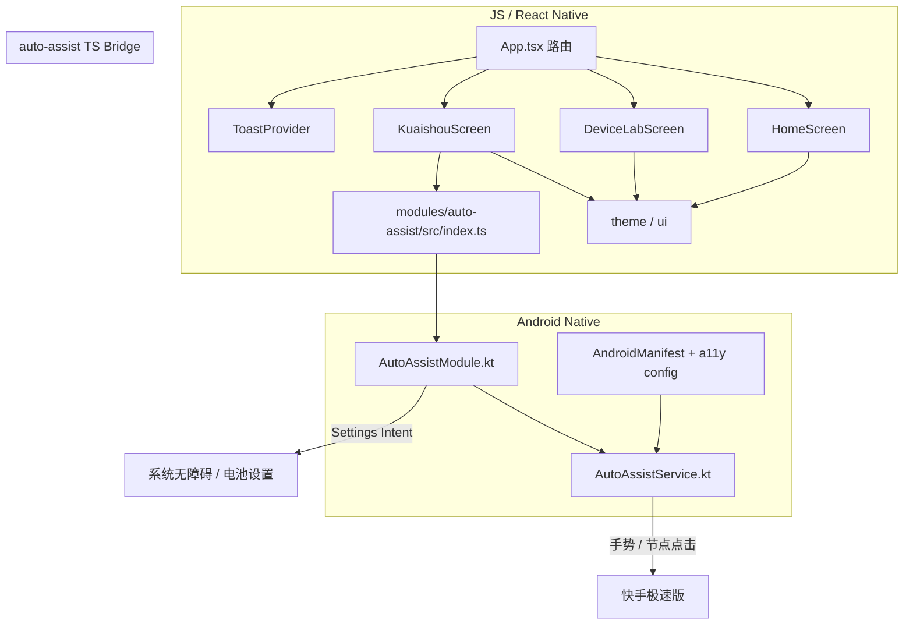
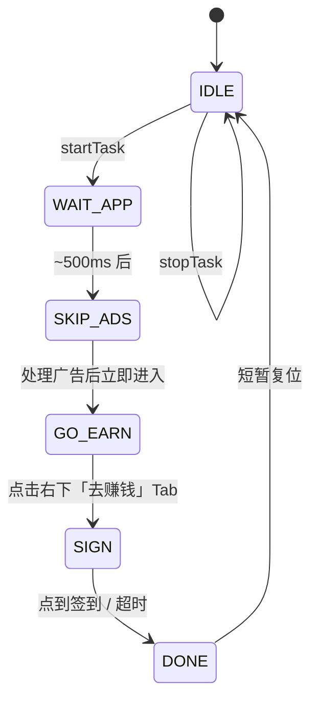

# 架构设计

## 1. 总体结构

应用采用「Expo JS 层 + 本地 Android Expo Module」双层结构。UI 与业务编排在 JS；真正的跨应用点击在 `AccessibilityService` 中执行。



## 2. 分层职责

| 层 | 路径 | 职责 |
| --- | --- | --- |
| 应用壳 | `App.tsx` | 简易路由、返回键、Toast / SafeArea |
| 页面 | `src/screens/*` | 功能 UI、状态、调用原生 API |
| 设计系统 | `src/theme.ts`、`src/ui.tsx` | 颜色、字号、通用组件 |
| 反馈 | `src/toast/*` | 全局 Toast |
| JS Bridge | `modules/auto-assist/src/index.ts` | 类型安全封装、平台兜底 |
| 原生 Module | `AutoAssistModule.kt` | Expo Module API、权限检测、启动任务 |
| 无障碍服务 | `AutoAssistService.kt` | 状态机、轮询、点击、进度事件 |

## 3. 导航模型

当前**未使用 Expo Router**，用内存状态切换页面，便于 Demo 体量：

```
home ──► device
  │
  └──► kuaishou
```

- 子页按返回键 → 回首页（`BackHandler`）
- 首页再按返回 → 交系统退出

## 4. auto-assist 模块

### 4.1 注册方式

- `expo-module.config.json` 声明 Android Module：`expo.modules.autoassist.AutoAssistModule`
- Manifest 注册 `AutoAssistService`，`BIND_ACCESSIBILITY_SERVICE`，`stopWithTask="false"`
- 能力配置：`res/xml/auto_assist_config.xml`（读窗口、执行手势等）

### 4.2 JS ↔ Native API

| API | 方向 | 说明 |
| --- | --- | --- |
| `isEnabled` | JS → Native | 读 `ENABLED_ACCESSIBILITY_SERVICES` |
| `openSettings` | JS → Native | 打开无障碍设置页 |
| `isIgnoringBatteryOptimizations` | JS → Native | 电池白名单状态 |
| `openBatteryOptimizationSettings` | JS → Native | 请求忽略电池优化 |
| `startKuaishouCheckIn(pkg)` | JS → Native | 启动签到状态机 |
| `stop` | JS → Native | 停止任务 |
| `onProgress` | Native → JS | `{ step, message, ok }` 进度事件 |

Module 在 `OnCreate` 把 `AutoAssistService.onProgress` 接到 Expo Event；`OnDestroy` 清理并 `stopTask()`。

### 4.3 签到状态机



| 阶段 | 策略 |
| --- | --- |
| `WAIT_APP` | `getLaunchIntent` 拉起目标包，抢点「跳过」等 |
| `SKIP_ADS` | 关键词点广告 / 弹窗，一轮后进入赚钱 |
| `GO_EARN` | 优先屏幕比例点击右下 Tab（文案常被屏蔽） |
| `SIGN` | 关键词找签到；失败则上方区域坐标兜底 |
| 超时 | 约 18s 强制 `DONE` |

点击策略优先级：

1. `AccessibilityNodeInfo` 关键词 + `ACTION_CLICK`（沿可点击父节点上溯）
2. 节点中心 `dispatchGesture` 轻触
3. 固定比例坐标（按实机截图校准，如赚钱 Tab ≈ `(0.90, 0.94)`）

轮询：赚钱 / 签到约 120ms，其它约 180ms；`onAccessibilityEvent` 也会推进一帧。

### 4.4 为何必须自定义 APK

Expo Go 不含本仓库的 `AccessibilityService`。只有把 Module 编进应用包后，系统设置里才会出现「工具箱自动签到」，JS 侧 `requireNativeModule('AutoAssist')` 才能成功。

## 5. UI 架构

- Material 风格浅色主题（`src/theme.ts`）
- 通用积木：`Screen` / `Section` / `Panel` / `Button` / `Chip` / `ListRow` 等（`src/ui.tsx`）
- 页面以 `ScrollView` + `Panel` 组织信息与操作，避免过度卡片化

## 6. 构建与分发链路


- 脚本：`pnpm build:apk` → `pnpm dlx eas-cli@26.0.0 build -p android --profile preview`
- 改 Kotlin / Manifest / a11y xml 后必须重新构建安装
- JS-only 改动在开发客户端上可热更新；纯 Expo Go 仍无原生能力

## 7. 稳定性相关设计

| 措施 | 作用 |
| --- | --- |
| `stopWithTask="false"` | 划掉任务时尽量不随 Task 停服务 |
| 忽略电池优化 API | 降低厂商杀后台概率 |
| App 回到前台刷新 `isEnabled` | 发现权限被关后引导重开 |
| 坐标兜底 | 应对目标 App 隐藏无障碍树 |

**无法保证**：永久授权、强停后仍可用、所有 ROM 杀进程后自动恢复。详见 [功能设计 · 权限](./features.md#4-权限与系统限制)。

## 8. 扩展建议

新增自动化玩法时建议：

1. 在 `AutoAssistService` 增加独立 Phase 或独立 Task，避免与签到状态机缠绕；
2. JS 只暴露 `startXxx` / 事件，不把点击坐标散落在多个 Screen；
3. 新原生能力继续放在 `modules/*` 本地 Expo Module，保持 CNG 干净。
