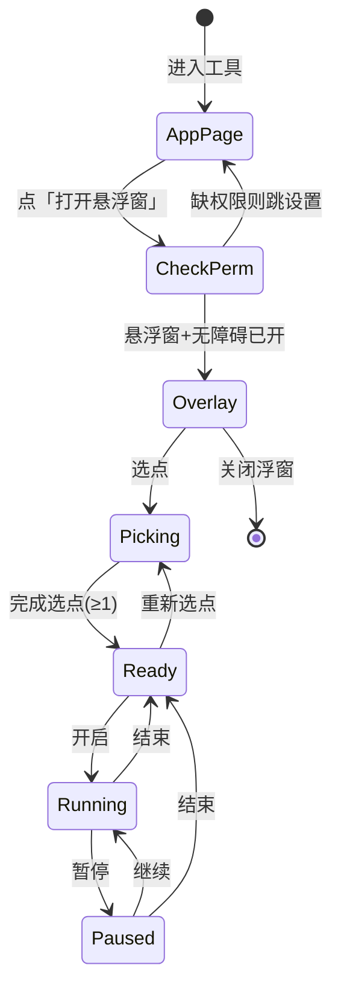
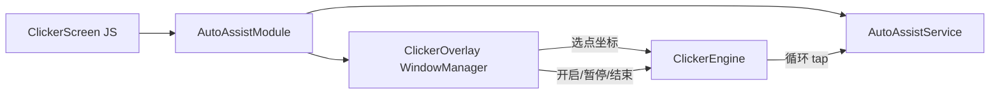

# 自动点击器 — 功能设计

## 1. 目标

在任意 App 上层提供**悬浮控制台**，用户可标定多个屏幕点位，按设定间隔循环自动点击；支持开启、暂停、结束。

本机自用辅助工具，需用户显式授权**悬浮窗**与**无障碍**。

## 2. 信息架构

```
首页「自动点击器」
  └─ 应用内说明页（权限 + 一个主按钮）
        └─ 打开系统悬浮窗控制台（可离开本 App）
              ├─ 选点模式（半透明全屏吃触摸）
              └─ 运行模式（小控制条 + 点位标记可选显示）
```

应用内页**不做**复杂点位编辑，只负责：

1. 说明能力与风险  
2. 引导开权限  
3. 一键「打开悬浮窗」

点位、启停全部在浮窗完成，避免切回本 App 才能操作。

## 3. 用户流程



### 分步说明

| 步骤 | 用户动作 | 系统表现 |
| --- | --- | --- |
| 1 | 开无障碍「工具箱自动签到」 | 用于真正点击 |
| 2 | 开「显示在其他应用上层」 | 用于浮窗 |
| 3 | 点「打开悬浮窗」 | 出现可拖拽控制条 |
| 4 | 点「选点」 | 全屏半透明，点哪里记哪里，显示序号气泡 |
| 5 | 点「完成」 | 退出选点，保留标记 |
| 6 | （可选）调间隔，如 500ms | 写入运行参数 |
| 7 | 点「开启」 | 按 1→2→…→1 循环手势点击 |
| 8 | 「暂停」/「继续」/「结束」 | 暂停停表；结束停点击并回到就绪 |

## 4. 浮窗 UI 草案

### 4.1 收起态（默认）

小圆钮 / 短条，可拖到屏幕边缘，避免挡操作。点击展开。

### 4.2 展开控制条

```
┌─────────────────────────────────────┐
│ ⋮⋮ 自动点击   间隔[ 800 ]ms    ✕   │
│ 点位: 3 个                          │
│ [选点] [清除] [开启|暂停] [结束]     │
└─────────────────────────────────────┘
```

| 控件 | 行为 |
| --- | --- |
| 选点 | 进入选点；运行中不可用 |
| 清除 | 清空点位与标记 |
| 开启 / 暂停 | 切换；无点位时禁用开启 |
| 结束 | 停止循环，状态回就绪 |
| ✕ | 关闭浮窗并停止点击 |
| 间隔 | 两次点击之间的毫秒数，建议 200–5000 |

### 4.3 选点层

- 全屏 `TYPE_APPLICATION_OVERLAY`，半透明遮罩  
- 触摸点记录为**屏幕绝对坐标**  
- 落点画圆 + 序号（1、2、3…）  
- 底部固定「完成选点 / 撤销上一点」，避免误记到底部按钮上（按钮区不采样或采样后忽略）

## 5. 技术架构



| 组件 | 职责 |
| --- | --- |
| `ClickerScreen` | 权限引导 + 打开浮窗 |
| `AutoAssistModule` | JS API：查权限、开设置、show/hide overlay |
| `ClickerOverlay` | 原生悬浮 UI、选点、控制按钮 |
| `ClickerEngine` | 状态机、点位列表、间隔、启停 |
| `AutoAssistService` | `dispatchGesture` 真正点击（复用现有无障碍） |

### 为何必须无障碍？

系统不允许普通 App 向其他 App 注入点击。悬浮窗只能**展示控件**；点击靠已有 `AccessibilityService` 发手势。

### 权限

| 权限 | 用途 |
| --- | --- |
| `SYSTEM_ALERT_WINDOW` | 浮窗 |
| 无障碍服务（已有） | 点击 |
| 建议忽略电池优化 | 后台循环不易被杀 |

## 6. 状态与规则

| 状态 | 可操作 |
| --- | --- |
| `idle` | 无浮窗 |
| `picking` | 加点 / 撤销 / 完成；不可开启 |
| `ready` | 选点、清除、开启、关浮窗 |
| `running` | 暂停、结束；隐藏或弱化选点 |
| `paused` | 继续、结束、清除（可选） |

约束：

- 最多例如 **20** 个点，防止误触刷屏  
- 间隔下限 **100ms**，保护误触与设备发热  
- 开启前校验无障碍仍连接；断开则 Toast / 浮窗提示并停  
- 「结束」≠ 关浮窗：只停循环；✕ 才拆浮窗  

## 7. 与现有功能关系

| 功能 | 关系 |
| --- | --- |
| 快手自动签到 | 共用 `AutoAssistService`；**同时只跑一个任务**（点开启点击器时停签到，反之亦然） |
| 定时提醒 | 无关 |

无障碍服务文案可逐步改为更中性的「工具箱辅助」，避免只写签到（可后续改）。

## 8. MVP 范围

**做**

- 应用内页 + 双权限引导  
- 可拖拽浮窗控制条  
- 多点选点 / 清除 / 完成  
- 循环点击 + 开启 / 暂停 / 结束  
- 可调间隔  

**暂不做**

- 按压时长 / 滑动手势  
- 随机偏移防检测  
- 云端脚本 / 录制回放 UI  
- iOS  

## 9. 风险说明（产品文案建议）

- 仅用于本人设备上的重复劳动辅助  
- 部分应用可能限制无障碍或检测异常点击  
- 覆盖安装后需重新开无障碍与悬浮窗  

## 10. 验收

- [ ] 无悬浮窗权限时能跳转设置  
- [ ] 无障碍未开时不能真正点上  
- [ ] 选 ≥1 点后可开启，屏幕对应位置有点击反馈  
- [ ] 暂停后不再点击，继续后恢复  
- [ ] 结束后停止；关浮窗后也不再点击  
- [ ] 与快手签到互斥，不会两套手势打架  
