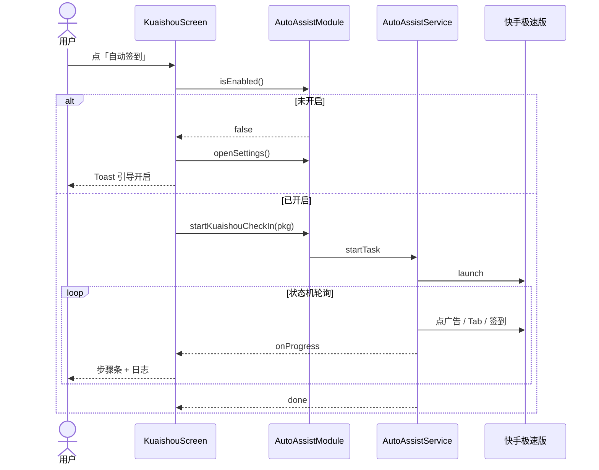

# 功能设计

## 1. 功能总览

| ID | 功能 | 入口 | 依赖 |
| --- | --- | --- | --- |
| F1 | 工具箱首页 | 启动默认页 | 无 |
| F7 | 自动点击器 | 首页 → 自动点击器 | Android + EAS APK + 无障碍 + 悬浮窗 |
| F6 | 定时提醒 | 首页 → 定时提醒 | `expo-notifications`（建议安卓真机 / 自定义包） |
| F2 | 快手极速版自动签到 | 首页 → 快手极速版签到 | Android + EAS APK + 无障碍 |
| F3 | 仅打开快手极速版 | 签到页按钮 | Android Intent |
| F4 | 无障碍 / 电池优化引导 | 签到页 | `auto-assist` |
| F5 | 系统能力实验室 | 首页 → 系统能力实验室 | 各 Expo 模块（Web 部分降级） |

---

## 2. F1 工具箱首页

### 目标

集中展示可用工具，一键进入。

### 交互

- 列表展示工具：标题、简介、分类标签
- 点击行进入对应页面
- 底部注明 Material / Expo 风格提示

### 当前工具配置

| 工具 | 分类 | 简述 |
| --- | --- | --- |
| 快手极速版签到 | 自动化 | 开 App → 跳广告 → 去赚钱 → 签到 |
| 系统能力实验室 | 开发 Demo | 震动、电量、传感器、亮度等 |

---

## 3. F6 定时提醒

### 目标

用户创建本地系统通知任务，支持三种触发方式。

| 方式 | 行为 |
| --- | --- |
| 多少分钟后 | `TIME_INTERVAL`，单次 |
| 指定时刻 | `DATE`，取今天该点；已过则明天 |
| 每天定点 | `DAILY`，每天 hour:minute 重复 |

### 交互

- 申请通知权限；安卓创建「定时提醒」通知渠道
- 填写标题 / 内容与时间参数后创建
- 列表展示已创建任务，可取消（取消系统调度 + 本地记录）
- 任务元数据存 AsyncStorage；真正触发由系统通知调度完成

### 注意

- 需允许通知；厂商省电可能推迟送达
- 含 `expo-notifications` 插件，改配置后需重新打 APK
- Web 仅作 UI 预览，不保证系统通知

---

## 4. F2 快手极速版自动签到

### 目标

在用户主动触发下，尽量自动完成快手极速版「去赚钱」页签到。

### 前置条件

1. 已安装包名 `com.kuaishou.nebula`
2. 已安装带 `auto-assist` 的自定义 APK
3. 系统无障碍中已开启「工具箱自动签到」
4. （推荐）忽略电池优化 + 厂商自启动白名单

### 主流程

### 步骤条设计

| 步骤 ID | 标题 | 成功判定 |
| --- | --- | --- |
| `service` | 开启无障碍服务 | `isEnabled === true` |
| `open` | 打开快手极速版 | Launch Intent 成功 |
| `ads` | 跳过首屏广告 | 关键词点击或超时进入下一步 |
| `earn` | 进入「去赚钱」 | 坐标 / 文案点击 Tab |
| `sign` | 点击签到 | 关键词或区域点击 |
| `done` | 完成 | 状态机结束 |

步骤状态：`idle` | `running` | `done` | `skip` | `fail`。

### 自动化策略（产品视角）

| 步骤 | 首选 | 回退 |
| --- | --- | --- |
| 广告 / 弹窗 | 文案：跳过、我知道了、以后再说… | 超时进入下一步 |
| 去赚钱 | 文案「去赚钱」；否则点第 4 个 Tab ≈ `(0.70, 0.94)` | 微偏移重试（勿点最右「我的」） |
| 签到 | 文案：立即签到、签到、领金币… | 屏幕上方区域比例点击 |

> 快手可能不暴露无障碍节点；日志若出现「未读到界面文案」，属预期，此时依赖坐标策略。

### 运行中行为

- 显示「执行中…」，禁用重复启动
- 可「停止任务」→ `stop()` 清空 Phase
- 接收 `onProgress` 刷新步骤与最近约 30 条日志
- 整体超时约 18 秒，避免卡死

### 非目标

- 不保证每天首次 / 非首次 UI 布局 100% 命中
- 不自动处理登录态、验证码、复杂活动页
- 不在后台无人值守定时执行

---

## 5. 权限与系统限制

### 5.1 无障碍

| 问题 | 说明 |
| --- | --- |
| 如何获取 | 仅能用户在系统设置中手动开启 |
| 能否永久授权 | **不能**（系统安全模型） |
| 何时会丢 | 覆盖安装、强行停止、部分厂商清理后台 |
| App 能做什么 | 检测状态、跳转设置、提示忽略电池优化 |

### 5.2 电池与厂商

建议用户完成：

1. 忽略电池优化（页内按钮）
2. 手机管家：自启动、关联启动、后台高耗电允许
3. 多任务锁定本应用
4. 少覆盖安装；定版后减少重装

### 5.3 其它权限

- `REQUEST_IGNORE_BATTERY_OPTIMIZATIONS`：用于请求电池白名单
- 无障碍服务权限由系统绑定，不走普通 runtime permission 弹窗
- 通知权限（安卓 13+）与 `expo-notifications` 通知渠道：定时提醒依赖此权限

---

## 6. F3 仅打开快手极速版

- 使用 `expo-intent-launcher` 按包名启动
- 失败时尝试跳转应用市场详情
- 不触发无障碍任务，用于手动操作或排查「能不能打开」

---

## 7. F4 引导与状态展示

签到页「运行环境」面板展示：

| Chip | 含义 |
| --- | --- |
| 原生模块就绪 / 不可用 | 是否加载到 `AutoAssist` |
| 无障碍已开 / 未开 | 服务是否在系统中启用 |
| 已忽略 / 未忽略电池优化 | PowerManager 白名单 |

另有说明卡片解释「为什么无障碍会自己关掉」，降低重复咨询成本。

从系统设置返回 App 时（`AppState === active`）自动刷新上述状态。

---

## 8. F5 系统能力实验室

### 目标

验证 Expo 官方模块在本工程中的可用性，并作为教学 / 调试面板。

### 能力清单（示意）

| 能力 | 模块 | 行为摘要 |
| --- | --- | --- |
| 设备 / 应用信息 | `expo-device` / `expo-application` | 展示型号、系统、版本等 |
| 电量 | `expo-battery` | 电量百分比、充电状态、监听 |
| 网络 | `expo-network` | 连接类型 / 离线 |
| 亮度 | `expo-brightness` | 读当前亮度 |
| 加速度计 | `expo-sensors` | 启停采样 xyz |
| 震动 | `expo-haptics` | 触发触觉反馈 |
| 剪贴板 | `expo-clipboard` | 复制设备摘要 |
| 分享 | `expo-sharing` / RN `Share` | 分享文本等信息 |

Web 上传感器等能力会降级或不可用，页面需可容忍失败（已有 try/catch）。

---

## 9. 反馈与体验

| 机制 | 用途 |
| --- | --- |
| Toast | 短结果：成功 / 失败 / 需要权限 |
| 步骤条 | 签到长流程可视化 |
| 日志列表 | 排查点没点到、文案是否可读 |
| 返回键 | 子页回首页，避免误杀进程导致无障碍被关 |

---

## 10. 验收要点

### 定时提醒

- [ ] 可申请通知权限
- [ ] 三种方式均可创建，并在列表显示
- [ ] 到点收到系统通知（真机）
- [ ] 取消后不再触发

---

### 自动签到（安卓 APK）

- [ ] 未开无障碍时，点击自动签到会跳设置并 Toast 提示
- [ ] 开启后能拉起快手极速版
- [ ] 多数情况下能进入「去赚钱」Tab（允许坐标点击）
- [ ] 能尝试点击签到或给出明确失败 / 超时日志
- [ ] 停止任务可中断
- [ ] 覆盖安装后无障碍关闭，再次开启可恢复

### 实验室

- [ ] 真机可展示电量、网络等基础信息
- [ ] 震动、复制、分享可触发且有 Toast

### 构建

- [ ] `pnpm build:apk` 可产出可安装包
- [ ] 安装后系统无障碍列表出现「工具箱自动签到」
